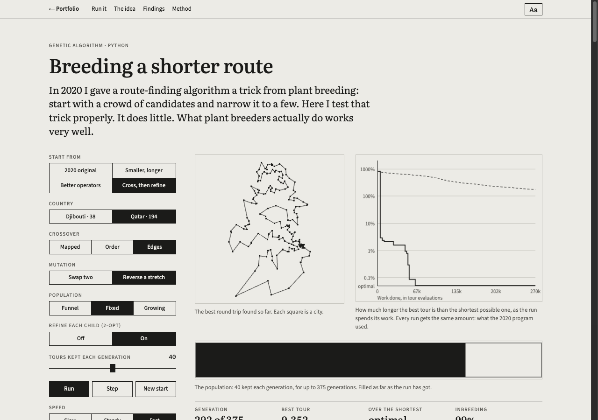

# Breeding a shorter route

[](https://github.com/mcrimi/GA_for_TSP_v2/actions/workflows/ci.yml)

A genetic algorithm for the travelling salesman problem, and a test of the plant-breeding idea
I built into it in 2020.

**[Run it in your browser](https://marianocrimi.com/tsp/)** · **[Read the analysis](https://marianocrimi.com/tsp/report/)**



## The question

In 2020 I was working with plant breeders. A breeding programme starts with a very large
number of plants and keeps fewer each year: the *selection funnel*. I gave my genetic
algorithm a population that shrank the same way, and wrote at the time that the results were
"not far off" a fixed population, "but I thought it would be fun to try". I never measured it.

This rebuild measures it, on national maps whose optimal tours are known, with every method
given exactly the work the 2020 program spent (269,800 tour evaluations) and 40 runs per
setting.

## What I found

Gap above the optimal tour of Qatar (194 cities), same budget for every row:

| Setting | Gap |
|---|---|
| 2020 program: partially mapped crossover, swap mutation, funnel 700 → 200 | 189% |
| Same, fixed population of the same average size | 187% |
| Same, fixed population of 50 | 141% |
| Inversion mutation instead of swap (fixed 100) | 27% |
| Edge recombination and inversion (fixed 100) | 24% |
| 2-opt local search from random tours, no breeding | 1.6% |
| Edge recombination, inversion and 2-opt on every child | 0.11% |
| Same, with a funnel 80 → 10 | 0.07%, optimal in 22 of 40 runs |

1. **The funnel is not what matters.** It behaves like a fixed population of about its average
   size: indistinguishable on Qatar, five points better on Djibouti. Choosing a better size
   is worth far more, and the best size differs from map to map.
2. **Operators that respect edges matter.** A tour's length is a sum over its edges, and the
   2020 operators preserved city positions instead.
3. **Two breeding measurements explain the 2020 result.** *Crossing cost*: children of decent
   parents were 50% longer than their parents under partially mapped crossover, against 9%
   under edge recombination. *Inbreeding*: by the end of a 2020 run the survivors shared 96% of
   their edges with the best tour.
4. **Cross, then refine.** A pedigree breeding programme crosses once and then spends years
   refining the progeny. The algorithmic counterpart is a memetic algorithm, crossover followed
   by local search, and it is the change that reaches the optimum.
5. **With local search the funnel has a narrow use**: best on Qatar when the budget is
   generous, clearly worse when it is tight (4.0% against 1.0% on Uruguay, 734 cities).

## Was the idea original?

No, and the report says so with references:

- Breeding theory in genetic algorithms: the Breeder Genetic Algorithm of Mühlenbein and
  Schlierkamp-Voosen (1993), with truncation selection and the breeder's equation.
- Populations that change size: GAVaPS, Arabas, Michalewicz and Mulawka (1994).
- Linear shrinking specifically: L-SHADE, Tanabe and Fukunaga (2014).
- Cheap screening for many, careful evaluation for few: successive halving in hyperparameter
  search. That is where the funnel pays, because evaluation there is expensive. A tour's
  length is cheap and exact.

What survives is the habit of measuring what a cross does.

## How it is built

```
src/tsp_ga/
  engine.py        the algorithm, compiled with Numba
  ga.py            settings, population schedules, breeding diagnostics
  instance.py      TSPLIB parsing, distances, neighbour lists
  rng.py           counter-based random numbers, identical in Python and JavaScript
  experiments.py   every comparison at the 2020 budget
  export.py        JSON for the page, and fixtures for the parity test
web/               the page; js/engine.js is a line-for-line port of engine.py
report/            the analysis (Quarto)
data/              Djibouti, Qatar and Uruguay, from the University of Waterloo
archive/           the 2020 program and its README, unchanged
```

The browser runs the same algorithm as Python, not an approximation of it. Distances are
integers and both sides draw random numbers from the same integer hash, so a test replays runs
exported from Python and requires the JavaScript engine to match every logged number in every
generation.

The 2020 Qatar run took 8.5 minutes. It now takes about a fifth of a second, which is what
makes several thousand runs affordable.

## Run it

```bash
uv sync --group report
uv run pytest                   # 50 tests
uv run tsp-ga run qa194 --crossover er --mutation inversion --local-search
uv run tsp-ga build             # all experiments, about 7 minutes on 12 cores
npm test                        # 22 tests, including Python-to-JavaScript parity
QUARTO_PYTHON=.venv/bin/python quarto render report/index.qmd
python3 -m http.server -d web   # the page, at http://localhost:8000
```

## Limits

Three maps and one main budget. Mutation rate and selection scheme are the 2020 ones. This is
a study of an idea, not a competitive solver: Concorde solves all three maps to optimality.

## Data and licence

Maps are the [national TSPs](https://www.math.uwaterloo.ca/tsp/world/countries.html) collected
by William Cook at the University of Waterloo, with their published optimal tour lengths. Code
is MIT licensed.
